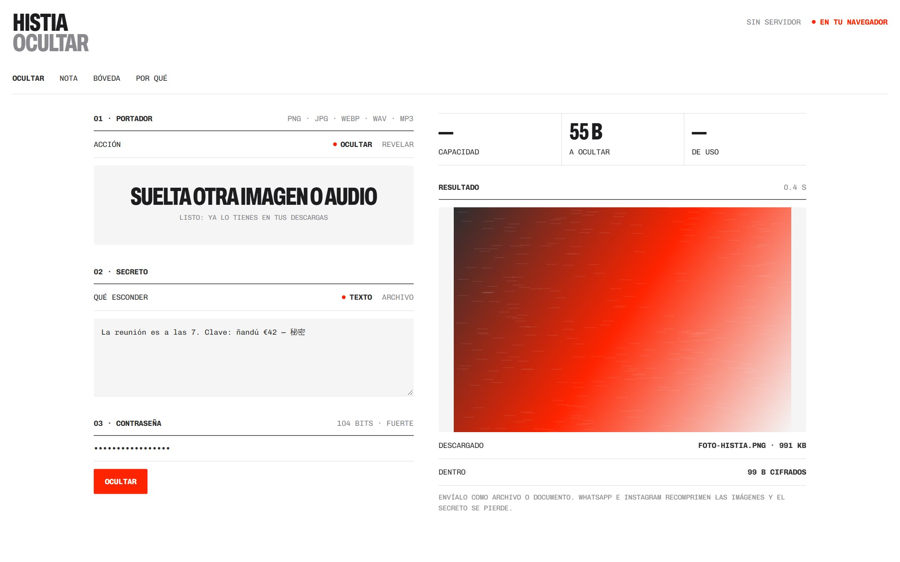
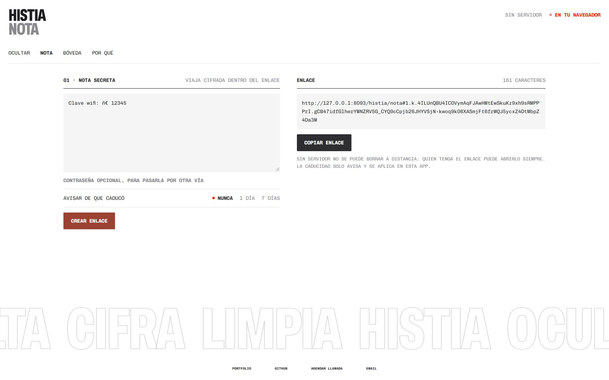
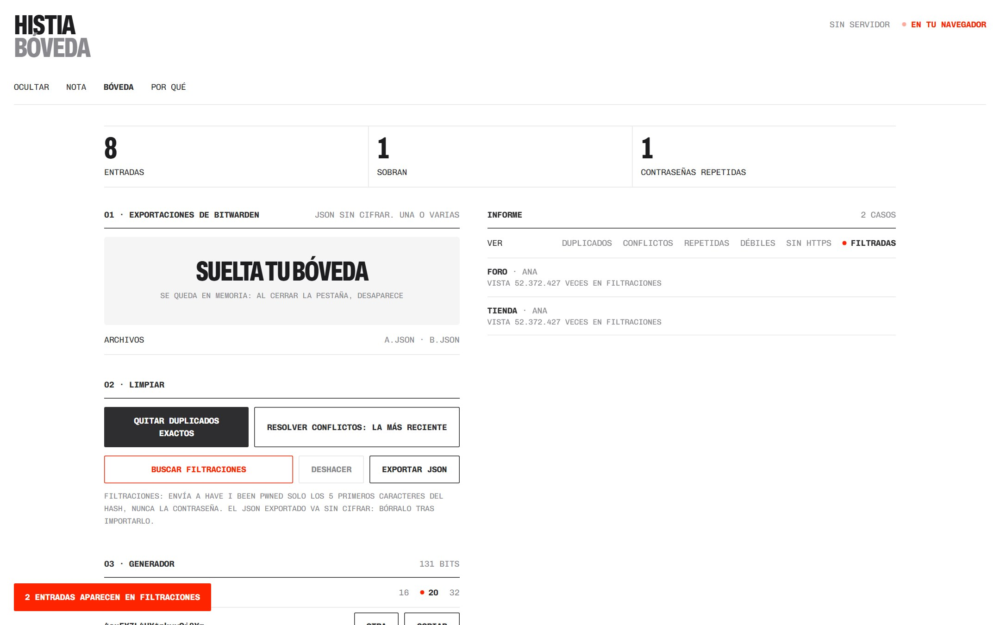
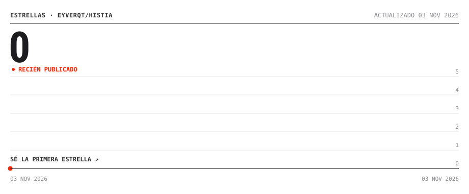

<h1>HISTIA</h1>

<p><samp>PRIVACIDAD&nbsp;SIN&nbsp;SERVIDOR&nbsp;&nbsp;&nbsp;&nbsp;&nbsp;&nbsp;<b>OCULTA,&nbsp;CIFRA&nbsp;Y&nbsp;LIMPIA</b>&nbsp;&nbsp;&nbsp;&nbsp;&nbsp;&nbsp;<b>●&nbsp;v1.0&nbsp;·&nbsp;PÚBLICO</b></samp></p>

<br>

<p align="center"></p>

<p align="center"><samp><a href="https://eyverqt.github.io/histia/"><b>▶&nbsp;ABRIR&nbsp;HISTIA</b></a>&nbsp;&nbsp;&nbsp;&nbsp;&nbsp;&nbsp;<a href="#por-que"><b>POR&nbsp;QUÉ&nbsp;HISTIA</b></a>&nbsp;&nbsp;&nbsp;&nbsp;&nbsp;&nbsp;<a href="https://eyverqt.netlify.app"><b>PORTFOLIO</b></a></samp></p>

<br>

<p align="center"><samp>
<b>HISTIA:&nbsp;&nbsp;&nbsp;&nbsp;&nbsp;&nbsp;&nbsp;&nbsp;&nbsp;&nbsp;&nbsp;&nbsp;&nbsp;&nbsp;&nbsp;(NADA&nbsp;SALE&nbsp;DE&nbsp;TU&nbsp;NAVEGADOR)&nbsp;&nbsp;&nbsp;&nbsp;&nbsp;&nbsp;&nbsp;&nbsp;&nbsp;&nbsp;&nbsp;&nbsp;&nbsp;&nbsp;&nbsp;&nbsp;</b><br>
<br>
<b>ÍNDICE&nbsp;01:&nbsp;QUÉ&nbsp;HACE&nbsp;&nbsp;&nbsp;(TRES&nbsp;HERRAMIENTAS,&nbsp;UN&nbsp;SOLO&nbsp;SITIO)&nbsp;&nbsp;&nbsp;&nbsp;&nbsp;&nbsp;&nbsp;&nbsp;&nbsp;</b><br>
<br>
<b>ÍNDICE&nbsp;02:&nbsp;NOVEDADES&nbsp;&nbsp;(v1.0:&nbsp;REESCRITA&nbsp;DESDE&nbsp;CERO)&nbsp;&nbsp;&nbsp;&nbsp;&nbsp;&nbsp;&nbsp;&nbsp;&nbsp;&nbsp;&nbsp;&nbsp;&nbsp;&nbsp;&nbsp;</b><br>
<br>
<b>ÍNDICE&nbsp;03:&nbsp;POR&nbsp;QUÉ&nbsp;&nbsp;&nbsp;&nbsp;(FRENTE&nbsp;A&nbsp;LO&nbsp;QUE&nbsp;YA&nbsp;EXISTE)&nbsp;&nbsp;&nbsp;&nbsp;&nbsp;&nbsp;&nbsp;&nbsp;&nbsp;&nbsp;&nbsp;&nbsp;&nbsp;&nbsp;&nbsp;&nbsp;</b><br>
<br>
<b>ÍNDICE&nbsp;04:&nbsp;USAR&nbsp;&nbsp;&nbsp;&nbsp;&nbsp;&nbsp;&nbsp;(SIN&nbsp;INSTALAR&nbsp;NADA)&nbsp;&nbsp;&nbsp;&nbsp;&nbsp;&nbsp;&nbsp;&nbsp;&nbsp;&nbsp;&nbsp;&nbsp;&nbsp;&nbsp;&nbsp;&nbsp;&nbsp;&nbsp;&nbsp;&nbsp;&nbsp;&nbsp;&nbsp;&nbsp;</b><br>
<br>
<b>ÍNDICE&nbsp;05:&nbsp;GALERÍA&nbsp;&nbsp;&nbsp;&nbsp;(NOTA&nbsp;Y&nbsp;BÓVEDA)&nbsp;&nbsp;&nbsp;&nbsp;&nbsp;&nbsp;&nbsp;&nbsp;&nbsp;&nbsp;&nbsp;&nbsp;&nbsp;&nbsp;&nbsp;&nbsp;&nbsp;&nbsp;&nbsp;&nbsp;&nbsp;&nbsp;&nbsp;&nbsp;&nbsp;&nbsp;&nbsp;&nbsp;</b><br>
<br>
<b>ÍNDICE&nbsp;06:&nbsp;LICENCIA&nbsp;&nbsp;&nbsp;(CÓDIGO&nbsp;MIT,&nbsp;CONTENIDO&nbsp;©&nbsp;EYVER&nbsp;GÓMEZ)&nbsp;&nbsp;&nbsp;&nbsp;&nbsp;&nbsp;</b><br>
<br>
<br>
<br>
Esconde&nbsp;mensajes&nbsp;y&nbsp;archivos&nbsp;dentro&nbsp;de&nbsp;una&nbsp;imagen&nbsp;o&nbsp;un&nbsp;audio.&nbsp;&nbsp;&nbsp;&nbsp;&nbsp;<br>
Comparte&nbsp;notas&nbsp;cifradas&nbsp;con&nbsp;un&nbsp;enlace,&nbsp;sin&nbsp;servidor&nbsp;de&nbsp;por&nbsp;medio.<br>
Limpia&nbsp;y&nbsp;une&nbsp;tus&nbsp;bóvedas&nbsp;de&nbsp;Bitwarden&nbsp;y&nbsp;busca&nbsp;claves&nbsp;filtradas.&nbsp;&nbsp;<br>
Sin&nbsp;instalar,&nbsp;sin&nbsp;cuenta&nbsp;y&nbsp;sin&nbsp;rastreadores.&nbsp;&nbsp;&nbsp;&nbsp;&nbsp;&nbsp;&nbsp;&nbsp;&nbsp;&nbsp;&nbsp;&nbsp;&nbsp;&nbsp;&nbsp;&nbsp;&nbsp;&nbsp;&nbsp;&nbsp;&nbsp;<br>
Una&nbsp;vez&nbsp;abierta&nbsp;funciona&nbsp;sin&nbsp;conexión.&nbsp;&nbsp;&nbsp;&nbsp;&nbsp;&nbsp;&nbsp;&nbsp;&nbsp;&nbsp;&nbsp;&nbsp;&nbsp;&nbsp;&nbsp;&nbsp;&nbsp;&nbsp;&nbsp;&nbsp;&nbsp;&nbsp;&nbsp;&nbsp;&nbsp;&nbsp;&nbsp;
</samp></p>

<br>

<p align="center"><samp>
<b>ÍNDICE&nbsp;01:&nbsp;QUÉ&nbsp;HACE&nbsp;&nbsp;&nbsp;(TRES&nbsp;HERRAMIENTAS,&nbsp;UN&nbsp;SOLO&nbsp;SITIO)&nbsp;&nbsp;&nbsp;&nbsp;&nbsp;&nbsp;&nbsp;&nbsp;</b><br>
<br>
OCULTAR&nbsp;&nbsp;&nbsp;TEXTO&nbsp;O&nbsp;ARCHIVOS&nbsp;DENTRO&nbsp;DE&nbsp;PNG,&nbsp;JPG,&nbsp;WEBP,&nbsp;WAV&nbsp;O&nbsp;MP3&nbsp;&nbsp;<br>
NOTA&nbsp;&nbsp;&nbsp;&nbsp;&nbsp;&nbsp;UN&nbsp;ENLACE&nbsp;QUE&nbsp;LLEVA&nbsp;LA&nbsp;NOTA&nbsp;CIFRADA&nbsp;DENTRO&nbsp;&nbsp;&nbsp;&nbsp;&nbsp;&nbsp;&nbsp;&nbsp;&nbsp;&nbsp;&nbsp;&nbsp;<br>
BÓVEDA&nbsp;&nbsp;&nbsp;&nbsp;DUPLICADOS,&nbsp;CONFLICTOS,&nbsp;REPETIDAS,&nbsp;DÉBILES&nbsp;Y&nbsp;FILTRADAS<br>
<br>
<b>CÓMO&nbsp;OCULTA:&nbsp;&nbsp;&nbsp;&nbsp;&nbsp;&nbsp;&nbsp;&nbsp;&nbsp;&nbsp;&nbsp;&nbsp;&nbsp;&nbsp;&nbsp;&nbsp;&nbsp;&nbsp;&nbsp;&nbsp;&nbsp;&nbsp;&nbsp;&nbsp;&nbsp;&nbsp;&nbsp;&nbsp;&nbsp;&nbsp;&nbsp;&nbsp;&nbsp;&nbsp;&nbsp;&nbsp;&nbsp;&nbsp;&nbsp;&nbsp;&nbsp;&nbsp;&nbsp;&nbsp;&nbsp;&nbsp;&nbsp;&nbsp;&nbsp;&nbsp;&nbsp;&nbsp;</b><br>
<br>
SECRETO&nbsp;&nbsp;&nbsp;&nbsp;&nbsp;&nbsp;&nbsp;&nbsp;&nbsp;&nbsp;&nbsp;&nbsp;&nbsp;&nbsp;&nbsp;&nbsp;&nbsp;&nbsp;&nbsp;&nbsp;&nbsp;&nbsp;&nbsp;&nbsp;&nbsp;&nbsp;&nbsp;&nbsp;&nbsp;&nbsp;&nbsp;&nbsp;&nbsp;&nbsp;&nbsp;&nbsp;&nbsp;&nbsp;&nbsp;&nbsp;&nbsp;&nbsp;&nbsp;&nbsp;&nbsp;&nbsp;&nbsp;&nbsp;&nbsp;&nbsp;&nbsp;&nbsp;&nbsp;&nbsp;&nbsp;&nbsp;&nbsp;<br>
→&nbsp;COMPRIMIR&nbsp;&nbsp;&nbsp;(DEFLATE:&nbsp;CABE&nbsp;MÁS)&nbsp;&nbsp;&nbsp;&nbsp;&nbsp;&nbsp;&nbsp;&nbsp;&nbsp;&nbsp;&nbsp;&nbsp;&nbsp;&nbsp;&nbsp;&nbsp;&nbsp;&nbsp;&nbsp;&nbsp;&nbsp;&nbsp;&nbsp;&nbsp;&nbsp;&nbsp;&nbsp;&nbsp;&nbsp;&nbsp;&nbsp;<br>
→&nbsp;CIFRAR&nbsp;&nbsp;&nbsp;&nbsp;&nbsp;&nbsp;(AES-256-GCM,&nbsp;PBKDF2&nbsp;CON&nbsp;600.000&nbsp;ITERACIONES)&nbsp;&nbsp;&nbsp;&nbsp;&nbsp;<br>
→&nbsp;REPARTIR&nbsp;&nbsp;&nbsp;&nbsp;(BITS&nbsp;AL&nbsp;AZAR&nbsp;SEGÚN&nbsp;TU&nbsp;CONTRASEÑA)&nbsp;&nbsp;&nbsp;&nbsp;&nbsp;&nbsp;&nbsp;&nbsp;&nbsp;&nbsp;&nbsp;&nbsp;&nbsp;&nbsp;&nbsp;&nbsp;<br>
→&nbsp;GUARDAR&nbsp;&nbsp;&nbsp;&nbsp;&nbsp;(PNG&nbsp;O&nbsp;WAV,&nbsp;SIN&nbsp;PÉRDIDA)&nbsp;&nbsp;&nbsp;&nbsp;&nbsp;&nbsp;&nbsp;&nbsp;&nbsp;&nbsp;&nbsp;&nbsp;&nbsp;&nbsp;&nbsp;&nbsp;&nbsp;&nbsp;&nbsp;&nbsp;&nbsp;&nbsp;&nbsp;&nbsp;&nbsp;&nbsp;
</samp></p>

<br>

<p align="center"><samp>
<b>ÍNDICE&nbsp;02:&nbsp;NOVEDADES&nbsp;&nbsp;(v1.0:&nbsp;REESCRITA&nbsp;DESDE&nbsp;CERO)&nbsp;&nbsp;&nbsp;&nbsp;&nbsp;&nbsp;&nbsp;&nbsp;&nbsp;&nbsp;&nbsp;&nbsp;&nbsp;&nbsp;&nbsp;&nbsp;&nbsp;&nbsp;&nbsp;&nbsp;&nbsp;&nbsp;&nbsp;&nbsp;</b><br>
<br>
<b>2026-11&nbsp;·&nbsp;HISTIA&nbsp;1.0&nbsp;&nbsp;&nbsp;&nbsp;&nbsp;&nbsp;&nbsp;&nbsp;&nbsp;&nbsp;&nbsp;&nbsp;&nbsp;&nbsp;&nbsp;&nbsp;&nbsp;&nbsp;&nbsp;&nbsp;&nbsp;&nbsp;&nbsp;&nbsp;&nbsp;&nbsp;&nbsp;&nbsp;&nbsp;&nbsp;&nbsp;&nbsp;&nbsp;&nbsp;&nbsp;&nbsp;&nbsp;&nbsp;&nbsp;&nbsp;&nbsp;&nbsp;&nbsp;&nbsp;&nbsp;&nbsp;&nbsp;&nbsp;&nbsp;&nbsp;&nbsp;&nbsp;&nbsp;&nbsp;</b><br>
<br>
Nace&nbsp;de&nbsp;la&nbsp;idea&nbsp;de&nbsp;Pixel&nbsp;Oculto,&nbsp;Llavero&nbsp;y&nbsp;Nota&nbsp;Cifrada,&nbsp;sin&nbsp;su&nbsp;código:&nbsp;&nbsp;&nbsp;<br>
sin&nbsp;React,&nbsp;sin&nbsp;PHP&nbsp;y&nbsp;sin&nbsp;build.&nbsp;HTML,&nbsp;CSS&nbsp;y&nbsp;JavaScript&nbsp;que&nbsp;se&nbsp;pueden&nbsp;leer.<br>
<br>
●&nbsp;NOTA&nbsp;SIN&nbsp;SERVIDOR&nbsp;&nbsp;&nbsp;&nbsp;(ANTES&nbsp;HACÍA&nbsp;FALTA&nbsp;PHP)&nbsp;&nbsp;&nbsp;&nbsp;&nbsp;&nbsp;&nbsp;&nbsp;&nbsp;&nbsp;&nbsp;&nbsp;&nbsp;&nbsp;&nbsp;&nbsp;&nbsp;&nbsp;&nbsp;&nbsp;&nbsp;&nbsp;&nbsp;&nbsp;&nbsp;&nbsp;&nbsp;&nbsp;<br>
●&nbsp;SIN&nbsp;MARCA&nbsp;&nbsp;&nbsp;&nbsp;&nbsp;&nbsp;&nbsp;&nbsp;&nbsp;&nbsp;&nbsp;&nbsp;(LO&nbsp;OCULTO&nbsp;NO&nbsp;LLEVA&nbsp;FIRMA&nbsp;RECONOCIBLE)&nbsp;&nbsp;&nbsp;&nbsp;&nbsp;&nbsp;&nbsp;&nbsp;&nbsp;&nbsp;&nbsp;&nbsp;&nbsp;<br>
●&nbsp;FILTRACIONES&nbsp;&nbsp;&nbsp;&nbsp;&nbsp;&nbsp;&nbsp;&nbsp;&nbsp;(HAVE&nbsp;I&nbsp;BEEN&nbsp;PWNED,&nbsp;SOLO&nbsp;SI&nbsp;LO&nbsp;PIDES)&nbsp;&nbsp;&nbsp;&nbsp;&nbsp;&nbsp;&nbsp;&nbsp;&nbsp;&nbsp;&nbsp;&nbsp;&nbsp;&nbsp;<br>
●&nbsp;CSP&nbsp;ESTRICTA&nbsp;&nbsp;&nbsp;&nbsp;&nbsp;&nbsp;&nbsp;&nbsp;&nbsp;(EL&nbsp;NAVEGADOR&nbsp;BLOQUEA&nbsp;CUALQUIER&nbsp;ENVÍO)&nbsp;&nbsp;&nbsp;&nbsp;&nbsp;&nbsp;&nbsp;&nbsp;&nbsp;&nbsp;&nbsp;&nbsp;&nbsp;
</samp></p>

<br>

<a id="por-que"></a>

<p align="center"><samp>
<b>ÍNDICE&nbsp;03:&nbsp;POR&nbsp;QUÉ&nbsp;&nbsp;&nbsp;&nbsp;(FRENTE&nbsp;A&nbsp;LO&nbsp;QUE&nbsp;YA&nbsp;EXISTE)&nbsp;&nbsp;&nbsp;&nbsp;&nbsp;&nbsp;&nbsp;&nbsp;&nbsp;&nbsp;&nbsp;&nbsp;&nbsp;&nbsp;&nbsp;&nbsp;&nbsp;&nbsp;&nbsp;&nbsp;&nbsp;&nbsp;&nbsp;&nbsp;&nbsp;</b><br>
<br>
PRIVATEBIN,&nbsp;0BIN&nbsp;&nbsp;&nbsp;&nbsp;ALGUIEN&nbsp;MANTIENE&nbsp;UN&nbsp;SERVIDOR&nbsp;&nbsp;&nbsp;&nbsp;&nbsp;&nbsp;&nbsp;&nbsp;&nbsp;&nbsp;&nbsp;&nbsp;&nbsp;&nbsp;&nbsp;&nbsp;&nbsp;&nbsp;&nbsp;&nbsp;&nbsp;&nbsp;&nbsp;&nbsp;&nbsp;&nbsp;<br>
BITWARDEN&nbsp;SEND&nbsp;&nbsp;&nbsp;&nbsp;&nbsp;&nbsp;NECESITA&nbsp;CUENTA;&nbsp;PASA&nbsp;POR&nbsp;SUS&nbsp;SERVIDORES&nbsp;&nbsp;&nbsp;&nbsp;&nbsp;&nbsp;&nbsp;&nbsp;&nbsp;&nbsp;&nbsp;&nbsp;&nbsp;&nbsp;<br>
BITWARDEN&nbsp;&nbsp;&nbsp;&nbsp;&nbsp;&nbsp;&nbsp;&nbsp;&nbsp;&nbsp;&nbsp;SIN&nbsp;LIMPIEZA&nbsp;AUTOMÁTICA&nbsp;DE&nbsp;DUPLICADOS&nbsp;&nbsp;&nbsp;&nbsp;&nbsp;&nbsp;&nbsp;&nbsp;&nbsp;&nbsp;&nbsp;&nbsp;&nbsp;&nbsp;&nbsp;&nbsp;&nbsp;<br>
SCRIPTS&nbsp;DE&nbsp;GITHUB&nbsp;&nbsp;&nbsp;HAY&nbsp;QUE&nbsp;INSTALAR&nbsp;PYTHON&nbsp;Y&nbsp;CONFIARLES&nbsp;TUS&nbsp;CLAVES&nbsp;&nbsp;&nbsp;&nbsp;&nbsp;&nbsp;&nbsp;<br>
WEBS&nbsp;DE&nbsp;ESTEGO&nbsp;&nbsp;&nbsp;&nbsp;&nbsp;&nbsp;MUCHAS&nbsp;SOLO&nbsp;TEXTO,&nbsp;CON&nbsp;LOS&nbsp;BITS&nbsp;EN&nbsp;ORDEN&nbsp;&nbsp;&nbsp;&nbsp;&nbsp;&nbsp;&nbsp;&nbsp;&nbsp;&nbsp;&nbsp;&nbsp;&nbsp;&nbsp;<br>
<br>
<b>LO&nbsp;MEDIDO&nbsp;(PORTÁTIL&nbsp;I5-1035G1,&nbsp;SIN&nbsp;GPU):&nbsp;&nbsp;&nbsp;&nbsp;&nbsp;&nbsp;&nbsp;&nbsp;&nbsp;&nbsp;&nbsp;&nbsp;&nbsp;&nbsp;&nbsp;&nbsp;&nbsp;&nbsp;&nbsp;&nbsp;&nbsp;&nbsp;&nbsp;&nbsp;&nbsp;&nbsp;&nbsp;&nbsp;&nbsp;&nbsp;&nbsp;&nbsp;&nbsp;&nbsp;</b><br>
<br>
1200×800&nbsp;+&nbsp;TEXTO&nbsp;&nbsp;&nbsp;&nbsp;0,7&nbsp;S&nbsp;&nbsp;&nbsp;&nbsp;&nbsp;&nbsp;&nbsp;&nbsp;&nbsp;&nbsp;&nbsp;&nbsp;&nbsp;&nbsp;&nbsp;&nbsp;&nbsp;&nbsp;&nbsp;&nbsp;&nbsp;&nbsp;&nbsp;&nbsp;&nbsp;&nbsp;&nbsp;&nbsp;&nbsp;&nbsp;&nbsp;&nbsp;&nbsp;&nbsp;&nbsp;&nbsp;&nbsp;&nbsp;&nbsp;&nbsp;&nbsp;&nbsp;&nbsp;&nbsp;&nbsp;&nbsp;&nbsp;&nbsp;&nbsp;<br>
12&nbsp;MP&nbsp;+&nbsp;1&nbsp;MB&nbsp;&nbsp;&nbsp;&nbsp;&nbsp;&nbsp;&nbsp;&nbsp;9,3&nbsp;S&nbsp;&nbsp;&nbsp;&nbsp;&nbsp;&nbsp;&nbsp;&nbsp;&nbsp;&nbsp;&nbsp;&nbsp;&nbsp;&nbsp;&nbsp;&nbsp;&nbsp;&nbsp;&nbsp;&nbsp;&nbsp;&nbsp;&nbsp;&nbsp;&nbsp;&nbsp;&nbsp;&nbsp;&nbsp;&nbsp;&nbsp;&nbsp;&nbsp;&nbsp;&nbsp;&nbsp;&nbsp;&nbsp;&nbsp;&nbsp;&nbsp;&nbsp;&nbsp;&nbsp;&nbsp;&nbsp;&nbsp;&nbsp;&nbsp;<br>
PETICIONES&nbsp;EXTERNAS&nbsp;0&nbsp;AL&nbsp;ABRIR&nbsp;UNA&nbsp;NOTA&nbsp;&nbsp;&nbsp;&nbsp;&nbsp;&nbsp;&nbsp;&nbsp;&nbsp;&nbsp;&nbsp;&nbsp;&nbsp;&nbsp;&nbsp;&nbsp;&nbsp;&nbsp;&nbsp;&nbsp;&nbsp;&nbsp;&nbsp;&nbsp;&nbsp;&nbsp;&nbsp;&nbsp;&nbsp;&nbsp;&nbsp;&nbsp;&nbsp;&nbsp;&nbsp;<br>
<br>
<b>SUS&nbsp;LÍMITES,&nbsp;SIN&nbsp;ADORNOS:&nbsp;&nbsp;&nbsp;&nbsp;&nbsp;&nbsp;&nbsp;&nbsp;&nbsp;&nbsp;&nbsp;&nbsp;&nbsp;&nbsp;&nbsp;&nbsp;&nbsp;&nbsp;&nbsp;&nbsp;&nbsp;&nbsp;&nbsp;&nbsp;&nbsp;&nbsp;&nbsp;&nbsp;&nbsp;&nbsp;&nbsp;&nbsp;&nbsp;&nbsp;&nbsp;&nbsp;&nbsp;&nbsp;&nbsp;&nbsp;&nbsp;&nbsp;&nbsp;&nbsp;&nbsp;&nbsp;&nbsp;&nbsp;&nbsp;</b><br>
<br>
●&nbsp;Un&nbsp;análisis&nbsp;forense&nbsp;serio&nbsp;puede&nbsp;notar&nbsp;que&nbsp;una&nbsp;imagen&nbsp;está&nbsp;muy&nbsp;llena.&nbsp;&nbsp;&nbsp;&nbsp;<br>
&nbsp;&nbsp;Usa&nbsp;menos&nbsp;del&nbsp;25&nbsp;%&nbsp;de&nbsp;la&nbsp;capacidad.&nbsp;&nbsp;&nbsp;&nbsp;&nbsp;&nbsp;&nbsp;&nbsp;&nbsp;&nbsp;&nbsp;&nbsp;&nbsp;&nbsp;&nbsp;&nbsp;&nbsp;&nbsp;&nbsp;&nbsp;&nbsp;&nbsp;&nbsp;&nbsp;&nbsp;&nbsp;&nbsp;&nbsp;&nbsp;&nbsp;&nbsp;&nbsp;&nbsp;&nbsp;&nbsp;&nbsp;&nbsp;<br>
●&nbsp;Sin&nbsp;servidor&nbsp;una&nbsp;nota&nbsp;no&nbsp;se&nbsp;puede&nbsp;borrar:&nbsp;quien&nbsp;tenga&nbsp;el&nbsp;enlace&nbsp;la&nbsp;abre.<br>
&nbsp;&nbsp;La&nbsp;caducidad&nbsp;solo&nbsp;avisa,&nbsp;dentro&nbsp;de&nbsp;esta&nbsp;app.&nbsp;&nbsp;&nbsp;&nbsp;&nbsp;&nbsp;&nbsp;&nbsp;&nbsp;&nbsp;&nbsp;&nbsp;&nbsp;&nbsp;&nbsp;&nbsp;&nbsp;&nbsp;&nbsp;&nbsp;&nbsp;&nbsp;&nbsp;&nbsp;&nbsp;&nbsp;&nbsp;&nbsp;<br>
●&nbsp;WhatsApp&nbsp;e&nbsp;Instagram&nbsp;recomprimen&nbsp;las&nbsp;imágenes&nbsp;y&nbsp;destruyen&nbsp;el&nbsp;secreto.&nbsp;&nbsp;&nbsp;<br>
&nbsp;&nbsp;Envíalas&nbsp;como&nbsp;archivo.&nbsp;&nbsp;&nbsp;&nbsp;&nbsp;&nbsp;&nbsp;&nbsp;&nbsp;&nbsp;&nbsp;&nbsp;&nbsp;&nbsp;&nbsp;&nbsp;&nbsp;&nbsp;&nbsp;&nbsp;&nbsp;&nbsp;&nbsp;&nbsp;&nbsp;&nbsp;&nbsp;&nbsp;&nbsp;&nbsp;&nbsp;&nbsp;&nbsp;&nbsp;&nbsp;&nbsp;&nbsp;&nbsp;&nbsp;&nbsp;&nbsp;&nbsp;&nbsp;&nbsp;&nbsp;&nbsp;&nbsp;&nbsp;&nbsp;&nbsp;<br>
●&nbsp;Nadie&nbsp;ha&nbsp;auditado&nbsp;este&nbsp;código.&nbsp;Para&nbsp;vidas&nbsp;en&nbsp;juego,&nbsp;usa&nbsp;otra&nbsp;cosa.&nbsp;&nbsp;&nbsp;&nbsp;&nbsp;&nbsp;
</samp></p>

<br>

<p align="center"><samp>
<b>ÍNDICE&nbsp;04:&nbsp;USAR&nbsp;&nbsp;&nbsp;&nbsp;&nbsp;&nbsp;&nbsp;(SIN&nbsp;INSTALAR&nbsp;NADA)&nbsp;&nbsp;&nbsp;&nbsp;&nbsp;&nbsp;&nbsp;&nbsp;&nbsp;&nbsp;&nbsp;&nbsp;&nbsp;&nbsp;&nbsp;&nbsp;&nbsp;&nbsp;&nbsp;&nbsp;&nbsp;&nbsp;&nbsp;&nbsp;&nbsp;&nbsp;&nbsp;&nbsp;&nbsp;&nbsp;&nbsp;&nbsp;&nbsp;&nbsp;&nbsp;</b><br>
<br>
ABRE&nbsp;&nbsp;&nbsp;&nbsp;&nbsp;&nbsp;&nbsp;&nbsp;&nbsp;&nbsp;EYVERQT.GITHUB.IO/HISTIA&nbsp;&nbsp;&nbsp;&nbsp;&nbsp;&nbsp;&nbsp;&nbsp;&nbsp;&nbsp;&nbsp;&nbsp;&nbsp;&nbsp;&nbsp;&nbsp;&nbsp;&nbsp;&nbsp;&nbsp;&nbsp;&nbsp;&nbsp;&nbsp;&nbsp;&nbsp;&nbsp;&nbsp;&nbsp;&nbsp;&nbsp;&nbsp;&nbsp;&nbsp;&nbsp;&nbsp;&nbsp;&nbsp;<br>
OCULTAR&nbsp;&nbsp;&nbsp;&nbsp;&nbsp;&nbsp;&nbsp;SUELTA&nbsp;UNA&nbsp;IMAGEN,&nbsp;ESCRIBE&nbsp;Y&nbsp;PON&nbsp;CONTRASEÑA&nbsp;&nbsp;&nbsp;&nbsp;&nbsp;&nbsp;&nbsp;&nbsp;&nbsp;&nbsp;&nbsp;&nbsp;&nbsp;&nbsp;&nbsp;&nbsp;&nbsp;&nbsp;&nbsp;<br>
REVELAR&nbsp;&nbsp;&nbsp;&nbsp;&nbsp;&nbsp;&nbsp;SUELTA&nbsp;LA&nbsp;IMAGEN&nbsp;Y&nbsp;ESCRIBE&nbsp;LA&nbsp;CONTRASEÑA&nbsp;&nbsp;&nbsp;&nbsp;&nbsp;&nbsp;&nbsp;&nbsp;&nbsp;&nbsp;&nbsp;&nbsp;&nbsp;&nbsp;&nbsp;&nbsp;&nbsp;&nbsp;&nbsp;&nbsp;&nbsp;&nbsp;<br>
NOTA&nbsp;&nbsp;&nbsp;&nbsp;&nbsp;&nbsp;&nbsp;&nbsp;&nbsp;&nbsp;ESCRIBE,&nbsp;CREA&nbsp;EL&nbsp;ENLACE&nbsp;Y&nbsp;PÁSALO&nbsp;&nbsp;&nbsp;&nbsp;&nbsp;&nbsp;&nbsp;&nbsp;&nbsp;&nbsp;&nbsp;&nbsp;&nbsp;&nbsp;&nbsp;&nbsp;&nbsp;&nbsp;&nbsp;&nbsp;&nbsp;&nbsp;&nbsp;&nbsp;&nbsp;&nbsp;&nbsp;&nbsp;&nbsp;&nbsp;<br>
BÓVEDA&nbsp;&nbsp;&nbsp;&nbsp;&nbsp;&nbsp;&nbsp;&nbsp;BITWARDEN&nbsp;→&nbsp;EXPORTAR&nbsp;→&nbsp;JSON&nbsp;→&nbsp;SUELTA&nbsp;EL&nbsp;ARCHIVO&nbsp;&nbsp;&nbsp;&nbsp;&nbsp;&nbsp;&nbsp;&nbsp;&nbsp;&nbsp;&nbsp;&nbsp;&nbsp;&nbsp;&nbsp;<br>
<br>
Para&nbsp;instalarla:&nbsp;en&nbsp;Chrome&nbsp;o&nbsp;Edge,&nbsp;botón&nbsp;Instalar&nbsp;de&nbsp;la&nbsp;barra&nbsp;de&nbsp;direcciones<br>
Para&nbsp;tu&nbsp;propio&nbsp;sitio:&nbsp;copia&nbsp;la&nbsp;carpeta&nbsp;y&nbsp;cambia&nbsp;&lt;base&nbsp;href&gt;&nbsp;en&nbsp;index.html.&nbsp;&nbsp;
</samp></p>

<br>

<p align="center"><samp>
<b>ÍNDICE&nbsp;05:&nbsp;GALERÍA&nbsp;&nbsp;&nbsp;&nbsp;(NOTA&nbsp;Y&nbsp;BÓVEDA)</b>
</samp></p>

<p align="center">&nbsp;</p>


<details>
<summary><samp><b>ESTRUCTURA&nbsp;DEL&nbsp;PROYECTO</b></samp></summary>

```text
histia/
├── index.html · 404.html  # La página y las rutas limpias en GitHub Pages
├── cripto.js              # AES-GCM, PBKDF2, notas y Have I Been Pwned
├── oculto.js              # Esteganografía en imagen y WAV
├── boveda.js              # Unir y limpiar exportaciones de Bitwarden
├── app.js · app.css       # Interfaz con el estilo eyverqt
├── sw.js                  # Sin conexión
└── scripts/estrellas.py   # La gráfica de estrellas (GitHub Actions)
```

</details>

<br>

<p align="center"><samp>
<b>ÍNDICE&nbsp;06:&nbsp;LICENCIA&nbsp;&nbsp;&nbsp;(CÓDIGO&nbsp;MIT,&nbsp;CONTENIDO&nbsp;©&nbsp;EYVER&nbsp;GÓMEZ)</b><br>
<br>
Código&nbsp;bajo&nbsp;MIT.&nbsp;Contenido&nbsp;y&nbsp;diseño&nbsp;©&nbsp;Eyver&nbsp;Gómez.&nbsp;&nbsp;&nbsp;&nbsp;&nbsp;&nbsp;&nbsp;&nbsp;&nbsp;<br>
Sin&nbsp;analíticas,&nbsp;sin&nbsp;cookies&nbsp;y&nbsp;sin&nbsp;dependencias&nbsp;externas.&nbsp;&nbsp;&nbsp;
</samp></p>

<br>

<p align="center"><samp>
<b>ESTRELLAS:&nbsp;&nbsp;&nbsp;&nbsp;&nbsp;&nbsp;&nbsp;&nbsp;&nbsp;&nbsp;&nbsp;&nbsp;(SE&nbsp;REDIBUJA&nbsp;SOLA&nbsp;CON&nbsp;CADA&nbsp;ESTRELLA)</b>
</samp></p>

<p align="center"><a href="https://github.com/eyverqt/histia/stargazers"></a></p>

<br>

<p align="center"><sub><samp><a href="https://eyverqt.netlify.app"><b>PORTFOLIO</b></a>&nbsp;&nbsp;&nbsp;&nbsp;&nbsp;&nbsp;<a href="https://github.com/eyverqt"><b>GITHUB</b></a>&nbsp;&nbsp;&nbsp;&nbsp;&nbsp;&nbsp;<a href="https://cal.com/eyverqt/15min"><b>AGENDAR&nbsp;LLAMADA</b></a>&nbsp;&nbsp;&nbsp;&nbsp;&nbsp;&nbsp;<a href="https://wa.me/573127115299"><b>WHATSAPP</b></a>&nbsp;&nbsp;&nbsp;&nbsp;&nbsp;&nbsp;<a href="mailto:eyverqt@gmail.com"><b>EMAIL</b></a>&nbsp;&nbsp;&nbsp;&nbsp;&nbsp;&nbsp;<a href="LICENSE"><b>LICENCIA</b></a></samp></sub></p>
